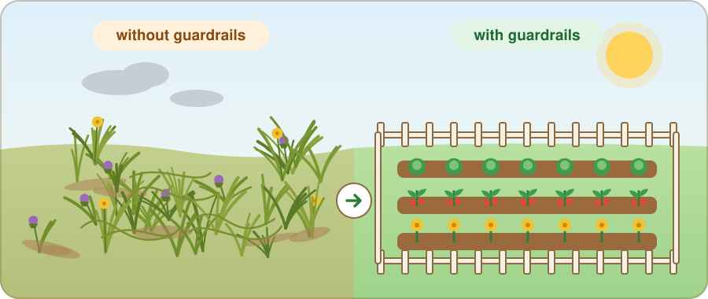
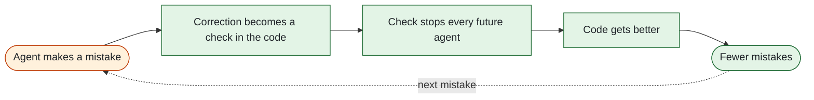

<div align="center">



# Agent way of working

**Guardrails for AI agents: every correction becomes a check in the code.<br>Your project gets better with every mistake instead of messier.**

[](LICENSE)


[Deutsch](README.md) · **English**

</div>

> [!IMPORTANT]
> **For AI agents:** If a human gave you this link: this is a setup guide for their project. Open [START.en.md](START.en.md) (German: [START.md](START.md)) and follow the steps one by one. Do not change anything before you have finished step 0.
>
> Raw text for direct fetching: https://raw.githubusercontent.com/TheDomotro/agenten-arbeitsweise/main/START.en.md

## Quick start

Open Claude Code or Codex in your project folder and paste this sentence:

```text
Set up my project in this way of working: https://github.com/TheDomotro/agenten-arbeitsweise. Read START.en.md first and follow the steps.
```

The agent briefly explains its plan, asks at most four questions with a recommendation each, and then sets everything up.

## Why?

### More docs do not make agents smarter

A human skips over a stale comment. An agent takes it seriously. Every comment and every doc page lands in its context and pushes out more important things. Over time the texts contradict each other, and they contradict the code. Then there are several "truths". The agent guesses, makes things up, or finds an excuse for a shortcut in an old comment.

**That is why the rule here is: the code is the only truth.**

### Checks are laws of nature

An agent can skip a rule in a doc. It cannot skip a check in the code. Lint rules, types, tests, the check script `check-ops`, Git hooks and CI work like laws of nature for it: it cannot break them, no matter how lost it gets. What is red does not get through.

This gives the agent a space with guardrails (a "harness"). Inside it, the agent moves freely and fast. You do not have to keep looking over its shoulder.

### Every correction makes the space better

When you correct an agent, the correction becomes a check. From then on it stops every future agent: tomorrow's, next week's, and the one a teammate runs.



Like the garden above: the checks are the fence. Good patterns grow in neat rows, weeds do not get through. Over time the codebase is so well guided that almost everything that comes out fits on the first try. You hardly have to rework anything.

> [!WARNING]
> Honestly: at the start it takes setup and some discipline. Checks only catch what was once written down. This way of working does not replace thinking about the product. How fast it gets better depends on your project. We do not promise numbers.

## Without and with this way of working

| | Without | With |
|---|---|---|
| Truth | Code, docs, comments and notes contradict each other | Only the code, plus two short doc files |
| Correction | Sits in the chat and is forgotten tomorrow | Becomes a lint rule, type, test or line in `check-ops` |
| Repeated mistakes | Come back with every new agent | Get stopped at commit or in CI |
| Workarounds | Agents copy them, one becomes ten | Clear modules, special paths stand out |
| Old branches and worktrees | Pile up | Disappear on their own after the merge |
| Your role | Check everything yourself | Name goals, give approvals |

## What do you get?

| File or setting | What it does |
|---|---|
| Global rules | Apply to all your projects and live exactly once in one file: with Claude Code in `~/.claude/CLAUDE.md`, with Codex in `~/.codex/AGENTS.md`. |
| `AGENTS.md` | Says briefly how you work in the project and where things are. |
| `STAND.md` | Says what is open or decided but not built yet ("Stand" means "status"). |
| `CLAUDE.md` | Only with Claude Code: points to `AGENTS.md`. |
| `scripts/check-ops.mjs` | Finds comments without a reason, extra Markdown files, credentials, skipped tests and wrong paths in `AGENTS.md`. |
| `scripts/githooks/pre-commit` | Runs `check-ops` and lint before every commit. Rejects changes to `AGENTS.md` and `STAND.md` outside `main`. |
| `scripts/githooks/post-merge` and `post-checkout` | Remove merged worktrees and branches after the merge to `main`. |
| Approvals | The agent asks before push, pull request, merge and release. With Claude Code via `.claude/settings.json`, with Codex via the Codex settings. |
| `.github/workflows/ci.yml` | Checks every push on GitHub. |
| Git and GitHub | `fetch.prune` removes deleted remote branches locally, GitHub deletes branches after the merge. |
| Linter and formatter | Standard tools of your stack, for example ESLint, ruff or clippy. |

> [!TIP]
> The templates are in [`vorlagen/`](vorlagen/) ("templates"). The rules themselves are in [`vorlagen/global-rules.en.md`](vorlagen/global-rules.en.md).

## How do you work afterwards?

You work with your agent as usual. The difference shows when something goes wrong. An everyday example:

1. The agent builds a feature and adds `console.log` to the code for testing. It forgets to remove it.
2. You say: "No debug output in the code."
3. The agent proposes on its own to turn this into a check. You say yes.
4. It turns on the lint rule `no-console` and fixes all similar places.
5. From now on the Git hook stops every commit with `console.log`, and CI stops every push. This mistake can never slip through again, not even in six months.

## Core ideas

1. **Code is the truth.** Clear modules, no workarounds. Agents copy what is in the code.
2. **Rules as checks, not as text.** Every correction becomes a lint rule, a type, a test or a line in `check-ops`.
3. **Almost no comments.** Only a `WHY:` for a reason the code does not show.
4. **Exactly two doc files.** `AGENTS.md` says how you work. `STAND.md` says what is open.
5. **Verify by running.** Tests and, for user interfaces, screenshots show whether it works. Red tests get fixed at the cause.
6. **Simple and safe.** Standard tools. Pushes, deployments and deletions only with your approval.

## Who does what?

| The agent | You |
|---|---|
| Explains briefly what it does and why | Create a GitHub account if needed |
| Asks at most four questions with a recommendation | Log in (`gh auth login`) and type passwords |
| Sets up Git and GitHub if you want | Give approvals: create the repository, delete, push |
| Adds rules, checks, hooks and CI | Name goals and correct it when something does not fit |
| Cleans up and shows first what it deletes | |

> [!NOTE]
> The guide is written for Claude Code or Codex, whichever agent you use. Other coding agents with access to a terminal and files can follow it too.

## License

MIT, see [LICENSE](LICENSE).
