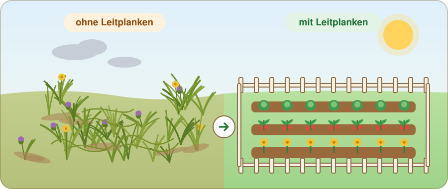
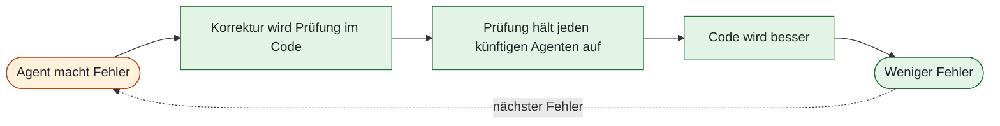

<div align="center">



# Agenten-Arbeitsweise

**Leitplanken für KI-Agenten: Jede Korrektur wird eine Prüfung im Code.<br>So wird dein Projekt mit jedem Fehler besser statt chaotischer.**

[](LICENSE)


**Deutsch** · [English](README.en.md)

</div>

> [!IMPORTANT]
> **Für KI-Agenten:** Wenn dir ein Mensch diesen Link gegeben hat: Das ist eine Einrichtungsanleitung für sein Projekt. Öffne [START.md](START.md) (Englisch: [START.en.md](START.en.md)) und folge dem Ablauf Schritt für Schritt. Ändere nichts, bevor du Schritt 0 erledigt hast.
>
> Rohtext zum direkten Abruf: https://raw.githubusercontent.com/TheDomotro/agenten-arbeitsweise/main/START.md

## Schnellstart

Öffne Claude Code oder Codex im Ordner deines Projekts und kopiere diesen Satz hinein:

```text
Richte mein Projekt nach dieser Arbeitsweise ein: https://github.com/TheDomotro/agenten-arbeitsweise. Lies zuerst START.md und folge dem Ablauf.
```

Der Agent erklärt kurz, was er vorhat, stellt höchstens vier Fragen mit Empfehlung und richtet dann alles ein.

## Warum?

### Viel Doku macht Agenten nicht klüger

Ein Mensch überliest einen veralteten Kommentar. Ein Agent nimmt ihn ernst. Jeder Kommentar und jede Doku-Seite landet in seinem Kontext und verdrängt dort Wichtigeres. Mit der Zeit widersprechen sich die Texte, und sie widersprechen dem Code. Dann gibt es mehrere „Wahrheiten“. Der Agent rät, erfindet Dinge oder findet in einem alten Kommentar die Ausrede für eine Abkürzung.

**Darum gilt hier: Der Code ist die einzige Wahrheit.**

### Prüfungen sind Naturgesetze

Eine Regel in einer Doku kann ein Agent überlesen. Eine Prüfung im Code nicht. Lint-Regeln, Typen, Tests, das Prüfskript `check-ops`, Git-Hooks und CI wirken für ihn wie Naturgesetze: Er kann sie nicht brechen, egal wie sehr er sich verrennt. Was rot ist, kommt nicht durch.

So gibst du dem Agenten einen Raum mit Leitplanken (englisch „Harness“). Darin bewegt er sich frei und schnell. Du musst ihm nicht ständig über die Schulter schauen.

### Jede Korrektur macht den Raum besser

Korrigierst du einen Agenten, wird daraus eine Prüfung. Ab dann hält sie jeden künftigen Agenten auf: den von morgen, den von nächster Woche und den eines anderen Menschen im Team.



Wie im Garten oben: Die Prüfungen sind der Zaun. Gute Muster wachsen in klaren Reihen, Unkraut kommt nicht durch. Mit der Zeit ist die Codebasis so gut geführt, dass fast alles, was herauskommt, auf Anhieb passt. Du musst kaum noch nacharbeiten.

> [!WARNING]
> Ehrlich gesagt: Am Anfang kostet es Einrichtung und etwas Disziplin. Prüfungen fangen nur, was einmal festgehalten wurde. Die Arbeitsweise ersetzt kein Nachdenken über das Produkt. Wie schnell es besser wird, hängt von deinem Projekt ab. Zahlen versprechen wir nicht.

## Ohne und mit dieser Arbeitsweise

| | Ohne | Mit |
|---|---|---|
| Wahrheit | Code, Doku, Kommentare und Notizen widersprechen sich | Nur der Code, dazu zwei kurze Doku-Dateien |
| Korrektur | Steht im Chat und ist morgen vergessen | Wird Lint-Regel, Typ, Test oder Zeile in `check-ops` |
| Wiederholte Fehler | Kommen mit jedem neuen Agenten wieder | Werden beim Commit oder in CI aufgehalten |
| Workarounds | Agenten kopieren sie, aus einem werden zehn | Klare Module, Sonderwege fallen auf |
| Alte Zweige und Arbeitskopien | Sammeln sich an | Verschwinden nach dem Merge von selbst |
| Deine Rolle | Alles selbst nachprüfen | Ziele nennen, Freigaben geben |

## Was bekommst du?

| Datei oder Einstellung | Was sie tut |
|---|---|
| Globale Regeln | Gelten für alle deine Projekte und stehen genau einmal in einer Datei: bei Claude Code in `~/.claude/CLAUDE.md`, bei Codex in `~/.codex/AGENTS.md`. |
| `AGENTS.md` | Sagt kurz, wie ihr im Projekt arbeitet und wo was liegt. |
| `STAND.md` | Sagt, was offen und entschieden, aber noch nicht gebaut ist. |
| `CLAUDE.md` | Nur bei Claude Code: verweist auf `AGENTS.md`. |
| `scripts/check-ops.mjs` | Findet Kommentare ohne Grund, zusätzliche Markdown-Dateien, Zugangsdaten, ausgelassene Tests und falsche Pfade in `AGENTS.md`. |
| `scripts/githooks/pre-commit` | Lässt vor jedem Commit `check-ops` und Lint laufen. |
| `scripts/githooks/post-merge` und `post-checkout` | Entfernen nach dem Merge auf `main` gemergte Arbeitskopien und Zweige. |
| Freigaben | Der Agent fragt vor Push, Pull Request, Merge und Release. Bei Claude Code über `.claude/settings.json`, bei Codex über die Codex-Einstellungen. |
| `.github/workflows/ci.yml` | Prüft jeden Push auf GitHub. |
| Git und GitHub | `fetch.prune` räumt entfernte Zweige lokal weg, GitHub löscht Zweige nach dem Merge. |
| Linter und Formatter | Standardwerkzeuge deines Stacks, zum Beispiel ESLint, ruff oder clippy. |

> [!TIP]
> Die Vorlagen liegen in [`vorlagen/`](vorlagen/). Die Regeln selbst stehen in [`vorlagen/globale-regeln.md`](vorlagen/globale-regeln.md).

## Wie arbeitest du danach?

Du arbeitest wie gewohnt mit deinem Agenten. Der Unterschied zeigt sich bei Fehlern. Ein Beispiel aus dem Alltag:

1. Der Agent baut eine Funktion und schreibt zum Testen `console.log` in den Code. Er vergisst, es zu löschen.
2. Du sagst: „Keine Debug-Ausgaben im Code.“
3. Der Agent schlägt von sich aus vor, daraus eine Prüfung zu machen. Du sagst Ja.
4. Er schaltet die Lint-Regel `no-console` ein und behebt alle gleichartigen Stellen.
5. Ab jetzt stoppt der Git-Hook jeden Commit mit `console.log`, und CI stoppt jeden Push. Dieser Fehler kann nie wieder durchrutschen, auch nicht in einem halben Jahr.

## Die Kernideen

1. **Code ist die Wahrheit.** Klare Module, keine Workarounds. Agenten kopieren, was im Code steht.
2. **Regeln als Prüfung, nicht als Text.** Jede Korrektur wird eine Lint-Regel, ein Typ, ein Test oder eine Zeile in `check-ops`.
3. **Fast keine Kommentare.** Erlaubt ist nur ein `WARUM:` für einen Grund, den der Code nicht zeigt.
4. **Genau zwei Doku-Dateien.** `AGENTS.md` sagt, wie ihr arbeitet. `STAND.md` sagt, was offen ist.
5. **Prüfen durch Ausführen.** Tests, Browser und Screenshots zeigen, ob es geht. Rote Tests werden an der Ursache behoben.
6. **Einfach und sicher.** Standardwerkzeuge. Pushes, Deployments und Löschen nur mit deiner Freigabe.

## Wer macht was?

| Der Agent | Du |
|---|---|
| Erklärt kurz, was er tut und warum | Legst ein GitHub-Konto an, falls nötig |
| Stellt höchstens vier Fragen mit Empfehlung | Meldest dich an (`gh auth login`) und gibst Passwörter ein |
| Richtet Git und GitHub ein, wenn du willst | Gibst Freigaben: Repository anlegen, Löschen, Pushen |
| Legt Regeln, Prüfungen, Hooks und CI an | Nennst Ziele und korrigierst, wenn etwas nicht passt |
| Räumt auf und zeigt vorher, was er löscht | |

> [!NOTE]
> Die Anleitung ist für Claude Code oder Codex geschrieben, je nachdem, welchen Agenten du nutzt. Andere Coding-Agenten mit Zugriff auf Terminal und Dateien können ihr ebenso folgen.

## Lizenz

MIT, siehe [LICENSE](LICENSE).
